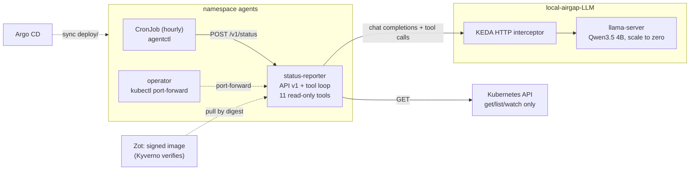

# local-agents

AI agents running inside the
[platform-lab](https://github.com/JGGHalfhide/platform-lab) Kubernetes
platform, calling the CPU-only, airgapped LLM endpoint from
[local-airgap-LLM](https://github.com/JGGHalfhide/local-airgap-LLM): per-agent
identity, read-only tools behind NetworkPolicy and Kyverno, every model and tool call traced, delivered through
the same signed supply chain and deployed to an airgapped cluster with no
internet. First agent: a read-only platform status reporter, scored
automatically by fault injection
([ADR 0003](docs/adr/0003-first-agent-status-reporter.md)). One agent by design: the lab is a proof of concept
(airgapped cluster, local LLM, one agent; [ADR 0006](docs/adr/0006-scope-mvp-no-triage-agent.md)).

**Status:** Week 2 (11/24): the status reporter runs in the cluster behind
an operator API and `agentctl` ([ADR 0005](docs/adr/0005-operator-interface.md)),
under its own read-only identity; image built with crane and signed
([ADR 0004](docs/adr/0004-agent-image-built-with-crane.md)). Fault-injection
eval: **8/8 faults found and classified, 5/5 healthy controls clean**
([eval-status.md](docs/eval-status.md#results-week-2-1124-resultsweek2-status-eval)).
Tools stay in-process functions, no tool servers
([ADR 0007](docs/adr/0007-tools-in-process.md)).

Week 3 (11/24): the eval's follow-ups closed; rerun **8/8 faults, 5/5
controls with no false findings in any run** (admission denials now located
at the blocked object), median 49 s per report
([eval-status.md](docs/eval-status.md#results-week-3-1124-resultsweek3-status-eval)).

Week 1 (v0.1, 11/24): VMs sized (12 vCPU / 20 GiB,
[resource plan](docs/resource-plan.md)), endpoint access decided
([ADR 0001](docs/adr/0001-endpoint-access-networkpolicy-only.md)),
evaluation set v0 of 22 real incidents with its scoring method
([eval.md](docs/eval.md)); model-alone baseline final (points of 88:
thinking off 38 greedy / 30 sampled, on 49 / 42). First agent: a read-only status reporter
([ADR 0003](docs/adr/0003-first-agent-status-reporter.md)), scored by fault
injection ([eval-status.md](docs/eval-status.md)).
Agent runtime: a plain tool loop on the openai SDK, chosen by a spike of five
runtimes ([ADR 0002](docs/adr/0002-agent-runtime-plain-openai-loop.md)). The
spike found that agent tool loops OOM-killed the endpoint; fixed in
local-airgap-LLM (its ADR 0007). See [ROADMAP.md](ROADMAP.md).

## How it fits

- **platform-lab** provides the clusters: VMs (Terraform), OS hardening,
  RKE2, Argo CD, Zot, Kyverno, cosign, monitoring, Velero, KEDA, Zarf.
- **local-airgap-LLM** provides the model endpoint: Qwen3.5 4B on
  llama.cpp, OpenAI-compatible, scale to zero, the model as a signed image.
- **This repo** provides the agents: agent workloads and their identity,
  tools, prompts and tool configs, tracing, the evaluation set and
  results, and the Zarf packages for the airgapped cluster.

## Architecture

How a run moves through it: [docs/stack.md](docs/stack.md#data-flow).

## Decisions

Architecture decision records are in [docs/adr/](docs/adr/). Every tool,
its version and why: [docs/stack.md](docs/stack.md).

## License

[MIT](LICENSE). Model weights and indexes are not in this repo; each
model's source, license and SHA-256 are recorded in the docs.
