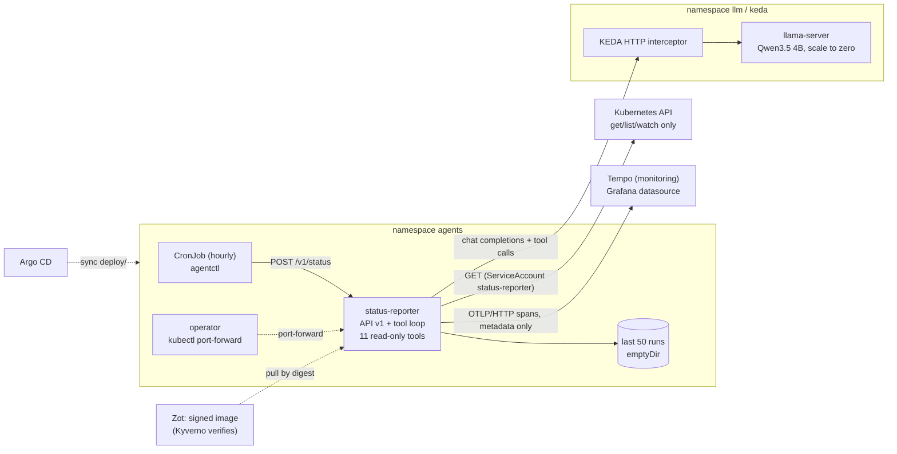

# Stack and pipeline

The full technical specification of local-agents: every tool and
component, its version, what it does here and why it was chosen; then the
pipeline from the cluster's state to a status report, how data moves at run time,
and a diagram. Decisions are recorded in [adr/](adr/). Same structure as
local-airgap-LLM's and platform-lab's docs/stack.md.

The clusters come from
[platform-lab](https://github.com/JGGHalfhide/platform-lab) and the model
endpoint from
[local-airgap-LLM](https://github.com/JGGHalfhide/local-airgap-LLM); their
stack.md files describe them in full. This page lists them only for what
they do for the agents.

Rows marked *planned* are on the [roadmap](../ROADMAP.md) and not built yet.
Keep this page current every week.

## Tech stack

### Inherited

| Component | Version | What it does here | Why |
|---|---|---|---|
| Build host | GMKtec K8 Plus, Ryzen 7 8845HS (8 cores / 16 threads, AVX-512), ~28 GiB usable, Arch Linux | Runs both VMs (one at a time), the builds, the evaluation runs | Personal hardware |
| Clusters | platform-lab v1.0+: RKE2 1.36 (CIS), Argo CD, Zot, Kyverno, cosign, Prometheus/Grafana/Loki/Alloy, Velero, KEDA, Zarf | Where the agents run, connected and airgapped | Phase 1 |
| Model endpoint | local-airgap-LLM v1.1: llama-server (llama.cpp v1.0.0), Qwen3.5 4B Q4_K_M, `http://llm-api.llm.svc:8080` | OpenAI-compatible chat completions with tool calls and JSON output; thinking off unless a request opts in (1024-token budget); 4 slots sharing one 32k KV pool; `--ctx-checkpoints 4` since 11/24 (local-airgap-LLM ADR 0007: the default got the pod OOMKilled under agent tool loops) | Phase 2 |

### Agents

| Component | Version | What it does here | Why |
|---|---|---|---|
| Agent image | python:3.14.9-slim-trixie@sha256:35caba83… base; 14 locked wheels (`agent/requirements.lock`, hashes); one reproducible layer appended with crane 0.22.1; user 65532; `python3 -m agent` | Packs the agent and its dependencies without a daemon or root; same digest on every build of a commit; `local-agents/agent:0.1.0` published 11/24 (`sha256:ef0bdcec…`), signed, admitted by Kyverno, an unsigned copy rejected ([scan](scans/week2-agent-image-admission.txt)) | No builder on the host and no new tool needed; output feeds platform-lab's SBOM, Trivy gate, push and cosign signing ([ADR 0004](adr/0004-agent-image-built-with-crane.md), [image-build.md](image-build.md)) |
| Agent runtime | openai SDK 3.46.0, a plain tool loop (agent/loop.py; locked in agent/requirements.lock); prompts and limits from deploy/agents/prompts/ (agent/profile.py, a ConfigMap synced by Argo CD; runs record `config_sha256`) | Runs the status reporter's tool loop against the endpoint at temperature 0: at most 8 tool calls, malformed tool arguments replaced before resending, a tool call required before any report, final structured request ending on a user turn; findings about objects the tools never showed are dropped (grounding), and `scaled-to-zero` findings on KEDA-managed workloads are dropped in code | 4/4 valid reports in the spike, fastest median, 14 wheels / 6 MiB, backend-neutral config ([ADR 0002](adr/0002-agent-runtime-plain-openai-loop.md), [spike](scans/week1-runtime-spike.txt), [footprint](scans/week1-runtime-footprint.txt)) |
| Tools | agent/tools.py (11/24), 11 tools as in-process functions: overview, list_namespaces, list_nodes, list_pods, list_workloads, list_events, list_keda_objects, list_pvcs, list_argocd_apps, pod_metrics, get_status (Deployments, StatefulSets, DaemonSets, Jobs, CronJobs, ...); Kubernetes API read with the standard library, GET only (agent/k8s.py: in-cluster ServiceAccount, `kubectl proxy`, or a recorded snapshot) | Compact rows capped at 3,500 characters; warnings about objects that are healthy now are hidden and counted; Kyverno PolicyViolation events shown at the blocked object; conditions where False is healthy (Suspended, Failed) shown only when True; KEDA scaling shown on workloads; no pod specs, env values or Secret names | The spike's false faults came from stale warnings and KEDA scale-to-zero; first live run: 0 false faults ([scan](scans/week2-status-reporter-live.txt), [ADR 0003](adr/0003-first-agent-status-reporter.md)); in-process rather than tool servers ([ADR 0007](adr/0007-tools-in-process.md)) |
| Endpoint access | NetworkPolicy (Canal), no API key | Agent namespaces and agent pods labelled `inference.local-airgap-llm/client: "true"` (both required by the interceptor's policy); tools unlabelled | [ADR 0001](adr/0001-endpoint-access-networkpolicy-only.md) |
| Operator interface | 11/24: HTTP API v1 (stdlib `http.server` in the agent image), `agentctl` (stdlib CLI); web view a Week 5-6 stretch | Starts a status run and returns structured, grounded findings with the tool-call trace; one path for operators, the CronJob and the eval | [ADR 0005](adr/0005-operator-interface.md), [interface.md](interface.md) |
| Identity and policy | deploy/agents/ (11/24): namespace `agents` (restricted Pod Security, client label), ServiceAccount `status-reporter`, ClusterRole get/list/watch only, NetworkPolicies (default deny; DNS, KEDA interceptor :8080, API server :6443 on the lab network), hourly CronJob; synced by Argo CD (platform-lab Application `local-agents`) | The status reporter reads the cluster and calls the endpoint, nothing else | Least privilege as specified in ADR 0003 and ADR 0001; checked with `kubectl auth can-i` and probe pods ([scan](scans/week2-identity-smoke.txt)) |
| Retrieval: embedding model, vector store, index | dropped (ADR 0006) | | |
| Tracing | OpenTelemetry SDK + OTLP/HTTP exporter 1.45.2 (agent/tracing.py, locked); Grafana Tempo 3.1.1 single binary in platform-lab (chart grafana-community/tempo 3.2.1, `monitoring`, 2 Gi local-path, 7 days), Grafana datasource | One trace per run: `invoke_agent` span, a `chat` span per model call (tokens, finish reason, latency), an `execute_tool` span per tool call (result size, latency); metadata only, no prompt, output or tool text; `trace_id` in the run object | Per-call latency and tokens across runs, in the Grafana that already runs; airgap-capable; one run = 18 spans, 8.2 KiB, Tempo 29-152 MiB ([ADR 0008](adr/0008-tracing-opentelemetry-tempo.md), [scan](scans/week4-tracing.txt)) |
| Evaluation set and scoring | v0: 22 cases (`eval/cases/`), `eval/check.py`, `eval/run_baseline.py`, `eval/review_sheet.py` | Real incidents from Phases 1-2 with known cause and fix; automatic first pass by patterns, then human review; leak check in CI | Decide by measurement; no judge model fits the lab ([eval.md](eval.md)) |
| Status reporter eval | eval/status/ (11/24): 13 cases in `agent-eval-*` namespaces, `inject.sh` / `cleanup.sh` (build cluster only, labelled namespaces only), `score.py`, `run_eval.py` through the operator API | Injects a fault or control, asks the status reporter, scores detect / locate / classify / grounding / tool validity | Automatic, repeatable scoring with no hand review (ADR 0003); Week 4: 8/8 faults, 5/5 controls, no ambient findings, median 49.4 s; CI requires results recorded with the deployed prompts and limits (`eval/status/check_config.py`) ([eval-status.md](eval-status.md)) |
| Zarf packages | *planned, Week 5* | | |

## Pipeline

1. **Code and lock.** agent/ (loop, tools, API server, agentctl) and
   agent/requirements.lock (hashes), committed.
2. **Image.** `make agent-image` (ADR 0004): crane appends one reproducible
   layer to the pinned Python base; the same commit gives the same digest.
3. **Supply chain.** platform-lab's `make image IMAGE=oci-layout:<dir>
   NAME=local-agents/agent:<commit>`: SBOM, Trivy gate, push to Zot, cosign
   signature; Kyverno verifies it at admission.
4. **Deploy.** deploy/ pins the image by digest; platform-lab's Argo CD
   Application `local-agents` syncs it into namespace `agents`.
5. **Run.** The hourly CronJob, an operator (port-forward) or the eval calls
   `POST /v1/status`; the run object (findings, evidence, tool calls,
   timings) is returned and kept with the last 50 runs.
6. **Eval.** eval/status/run_eval.py injects one fault or control in an
   `agent-eval-*` namespace, runs the agent through the same API, scores it
   (results/week2-status-eval/).
7. **Airgap** (Week 5): the same image and manifests as Zarf packages.

## Data flow

A status run, in the cluster:

1. `agentctl status` (a pod labelled `app.kubernetes.io/name: agentctl`)
   sends `POST /v1/status` to the `status-reporter` Service :8080; the
   ingress NetworkPolicy admits only agentctl pods. Operators reach the
   pod with `kubectl port-forward` (RBAC on `pods/portforward`).
2. The server starts the tool loop (one run at a time, 300 s deadline).
3. Each model call goes to `http://llm-api.llm.svc:8080/v1` through the KEDA
   HTTP interceptor; the egress NetworkPolicy allows only DNS, the
   interceptor and the API server, and the interceptor admits only labelled
   pods in labelled namespaces (ADR 0001). A cold endpoint scales from zero
   (~6 s).
4. Each tool call is a GET to the Kubernetes API server (:6443 on the lab
   network) with the `status-reporter` ServiceAccount token
   (get/list/watch only, no Secrets, no logs, no exec); the result is
   reduced to capped rows before the model sees it.
5. The final report is checked against the tool results (grounding) and
   stored as JSON in an emptyDir; agentctl prints it and exits 0 (healthy),
   1 (fault) or 2 (error / unknown).
6. Each model call and tool call is a span; at the end of the run the
   trace (metadata only, ADR 0008) goes as OTLP/HTTP to Tempo
   (`tempo.monitoring.svc:4318`), and the run object records its
   `trace_id`.

Nothing leaves the cluster: no egress beyond DNS, the interceptor, the API
server and Tempo.

## Diagram

